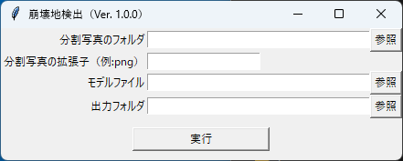
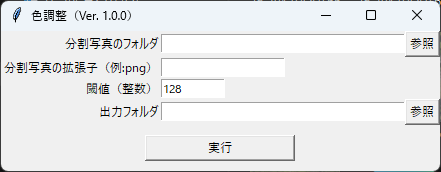

# 「崩壊地抽出AIアプリ」と「色調整アプリ」
このリポジトリでは「崩壊地抽出AIアプリ」と「色調整アプリ」のPythonスクリプトとWindows用アプリ（EXEファイル）を提供しています。
これらのWindows用アプリはインストール不要で、画面でフォルダやファイルを選択できるようになっています。

なお、これらは、 内閣府の”研究開発とSociety5.0との橋渡しプログラム（BRIDGE）”において、令和6年度に採択された「迅速な災害復旧等に向けた時系列・三次元モデルを用いた国土履歴のAI判別技術の開発・普及」の「テーマ⑶　時系列デジタルツインを活用した情報抽出技術の開発・実証」の一環として開発しました。

## アプリのダウンロード
アプリとAIモデルファイル（カラー版とグレースケール版）は、[Release](https://github.com/KouichiAraki/LandslideDebrisFlowAreaDetection/releases/tag/v1.0.0)
からダウンロードできます。

## 崩壊地抽出AIアプリ
崩壊地抽出AI.exeをダブルクリックすることで画面が表示されます。
各項目を選択・入力して「実行」ボタンをクリックすると、AIによる抽出が開始されます。
「モデルファイル」は、入力となる分割画像がカラーであればAiModel_Color.h5を選択し、グレースケールであればAiModel_Gray.h5を選択してください。

## 色調整アプリ
色調整.exeをダブルクリックすると画面が表示されます。
各項目を選択・入力して「実行」ボタンをクリックすると、グレースケールの分割画像に対して色調整が開始されます。
「閾値（整数）」はマスクするための閾値です。詳細は[1]を参照ください。

# ライセンス
[MIT](https://github.com/tcnksm/tool/blob/master/LICENCE)

# Reference
[1]荒木光一、藤田達大、河村知記、藤原大佑、大丸裕武、戸田 堅一郎、村上 亘、'AIを用いた崩壊地検出におけるグレースケールの空中写真に対する色調整の検討'、日本地すべり学会 第64回研究発表会、pp.273-274、2025年9月

# 著者
五大開発株式会社　システム技術部　技術研究所　荒木光一

国立研究開発法人　森林研究・整備機構　森林総合研究所　森林防災研究領域　村上亘
